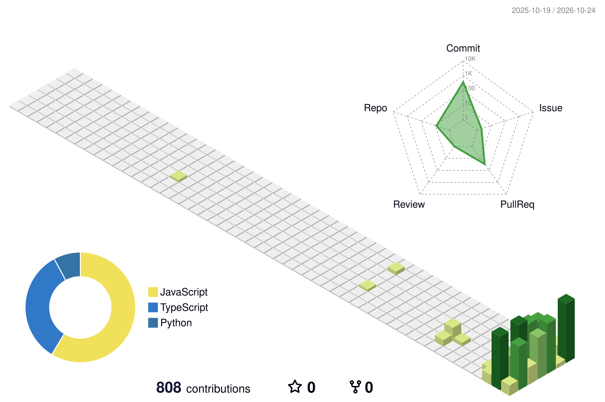

  
   
  

<!-- Animated pixel ninja companion -->

  

<table>
  <tr>
    <td width="62%" valign="middle">
      <h2>// ABOUT ME</h2>
      
Hey, I'm Riiddev. I'm not an expert, and I'm not trying to act like one. I just like learning new things, trying them out, and seeing what I can make.

      
These days I'm mostly into <strong>web design and frontend development</strong> — the little details, smooth interactions, and making a page feel good to use. I'm also starting to explore <strong>backend development</strong>, one level at a time.

      
Current mood: curious, a little pixelated, and taking it one step at a time.

      
      
    </td>
    <td width="38%" align="center" valign="middle">
      
       
      just vibing while the code loads
    </td>
  </tr>
</table>

---

## // WHAT I'M EXPLORING

<table>
  <tr>
    <td width="50%" valign="top">
      <h3>01 — Frontend & UI</h3>
      Layout, typography, responsive design, interaction details, and motion that feels intentional.
    </td>
    <td width="50%" valign="top">
      <h3>02 — Backend basics</h3>
      Learning how apps handle data, connect services, and work behind the interface.
    </td>
  </tr>
  <tr>
    <td width="50%" valign="top">
      <h3>03 — Build, break, repeat</h3>
      Trying ideas in projects, finding what breaks, and improving them as I learn.
    </td>
    <td width="50%" valign="top">
      <h3>04 — Pixel & motion</h3>
      Into expressive interfaces, playful motion, and small details that give a project personality.
    </td>
  </tr>
</table>

## // LANGUAGES & TOOLS IN MY PROJECTS

  
    
  
  
  
  
  
Languages found in the accessible project files, including private repositories: HTML, CSS, JavaScript, TypeScript, and Google Apps Script (.gs). JSON, YAML, and Markdown are included as supporting/configuration formats. React, Vite, GSAP, and Remotion are tools/frameworks rather than separate programming languages.

## // STATUS MY SCREEN

  
  

  

## // CONTRIBUTIONS IN 3D

  <picture>
    <source media="(prefers-color-scheme: dark)" srcset="./profile-3d-contrib/profile-night-green.svg" />
    <source media="(prefers-color-scheme: light)" srcset="./profile-3d-contrib/profile-green.svg" />
    
  </picture>
  Generated automatically from GitHub contribution activity.

## // SOUNDTRACK & ON REPEAT

  
  
A little soundtrack for learning, designing, and figuring things out. Click the player to open the playlist on Spotify.

## // PAC-MAN ARCADE

  <picture>
    <source media="(prefers-color-scheme: dark)" srcset="https://raw.githubusercontent.com/riiddev/riiddev/output/pacman-contribution-graph-dark.svg" />
    <source media="(prefers-color-scheme: light)" srcset="https://raw.githubusercontent.com/riiddev/riiddev/output/pacman-contribution-graph.svg" />
    
  </picture>
  Pac-Man is chasing the little blocks of progress.. Updated automatically by GitHub Actions.

